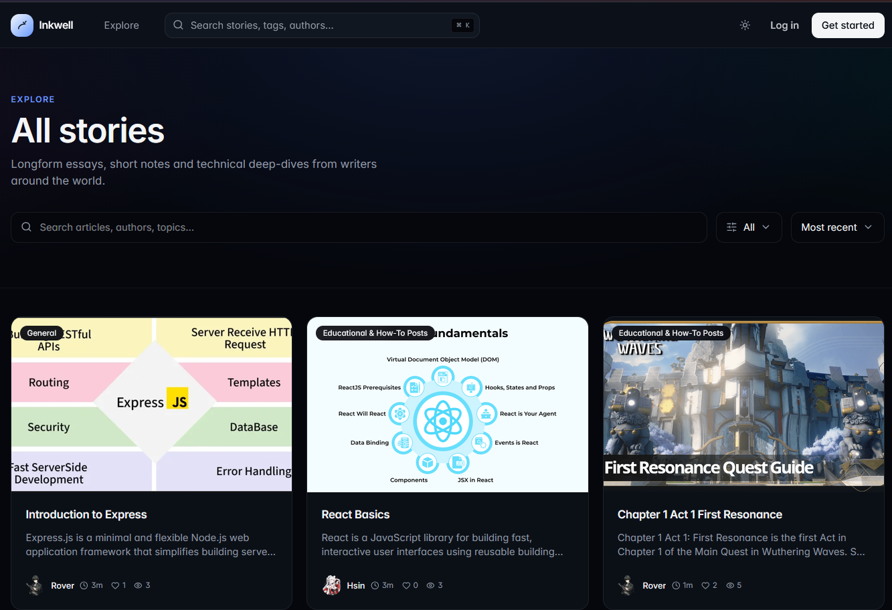
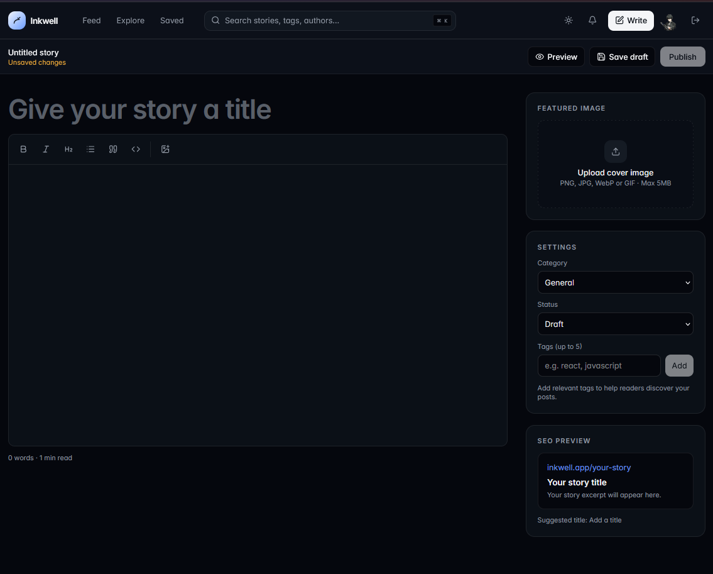
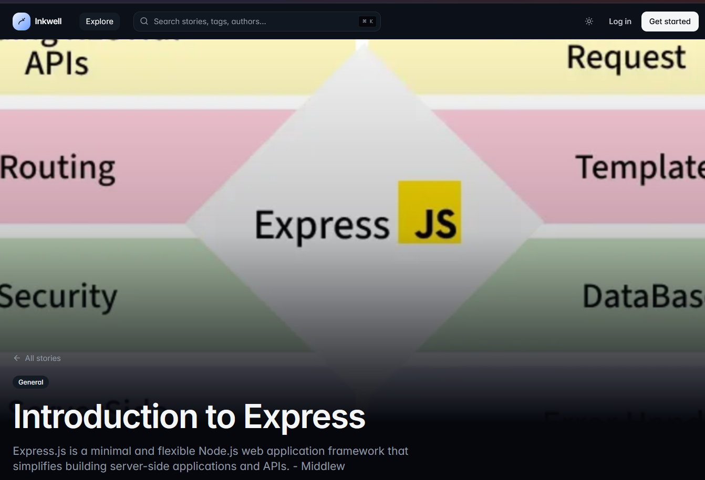
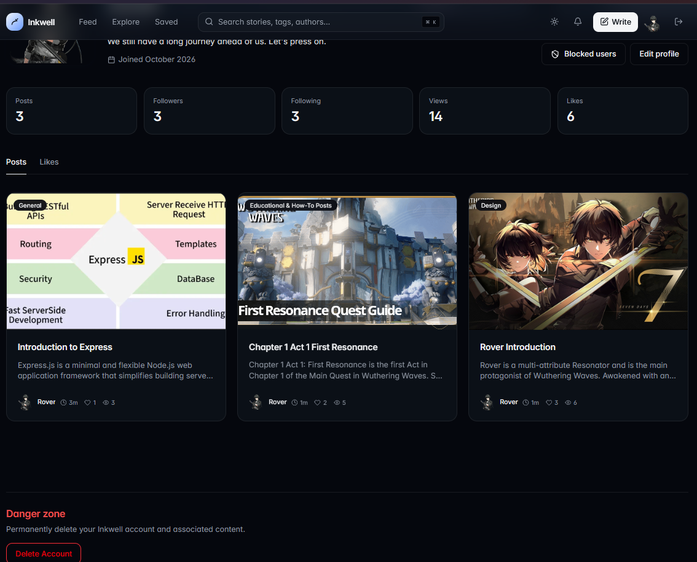
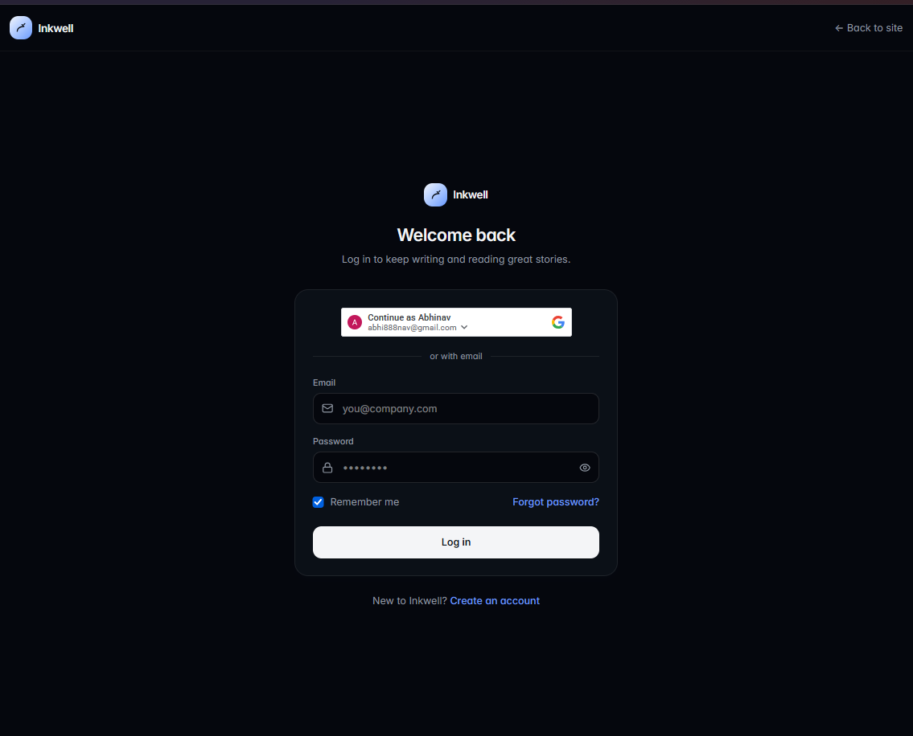

# Inkwell

A modern blogging and social publishing platform where writers can create, discover, and share stories, connect with other authors, and build a reading community.

**Live application:** [https://inkwell-lilac-ten.vercel.app/](https://inkwell-lilac-ten.vercel.app/)

---

## Preview

### Explore stories
Search and discover stories, authors, and topics, or browse content by category.



### Home feed
Discover featured stories, trending posts, categories, recent posts, popular tags, and authors.



### Reading experience
Read stories with a featured cover, author information, an on-page contents panel, comments, and related stories.



### Writing experience
Create stories with a rich-text editor, cover image, category, publication status, tags, and an SEO preview.



### Author profiles
View profile information, posts, social statistics, and account controls.



---

## Features

- **Authentication:** Email/password sign-up and login, with Google sign-in.
- **Story publishing:** Create, edit, save drafts, and publish posts.
- **Writing tools:** Add cover images, select categories, add tags, and preview SEO information.
- **Explore:** Search and discover stories, authors, and topics.
- **Personalized feed:** Browse featured and trending content, categories, recent posts, and popular tags.
- **Reading experience:** Read stories with author details, reading-time information, and an on-page contents section.
- **Social interactions:** Like posts, comment, reply to comments, and follow authors.
- **Save for later:** Bookmark stories and access them from your saved library.
- **Notifications:** View activity such as likes, comments, and new followers.
- **Profiles:** View posts, likes, followers, following, views, and profile information.
- **User controls:** Edit your profile, manage blocked users, and delete your account.
- **Dark and light appearance:** Switch between the available themes.

## Tech Stack

| Area | Technologies |
|---|---|
| Frontend | React, TypeScript, Vite |
| Routing | TanStack Router |
| Styling | Tailwind CSS |
| Backend | Node.js, Express.js |
| Database | PostgreSQL (Supabase) |
| Authentication | JWT, Google OAuth |
| Realtime communication | Socket.IO |
| Image storage | Cloudinary |
| Deployment | Vercel (frontend), Render (backend) |

## Architecture

Inkwell follows a client-server architecture.

1. The React frontend handles the user interface and user interactions.
2. The frontend communicates with the Express backend through API requests.
3. Express routes and middleware handle authentication and application logic.
4. The backend communicates with PostgreSQL using the `pg` package.
5. Cloudinary stores uploaded images.
6. Socket.IO supports realtime application updates.

```text
                 ┌──────────────────────┐
                 │     React Client     │
                 │  TypeScript + Vite   │
                 └──────────┬───────────┘
                            │ HTTP / Socket.IO
                            ▼
                 ┌──────────────────────┐
                 │    Express Server    │
                 │  Routes + Middleware │
                 └──────┬────────┬──────┘
                        │        │
                   SQL  │        │ Image uploads
                        ▼        ▼
               ┌────────────┐ ┌────────────┐
               │ PostgreSQL │ │ Cloudinary │
               │  Supabase  │ │   Storage  │
               └────────────┘ └────────────┘
```

## Getting Started

### 1. Clone the repository

```bash
git clone https://github.com/Abhi9085/Inkwell.git
cd Inkwell
```

### 2. Install dependencies

Install frontend and backend dependencies separately:

```bash
cd client
npm install
```

```bash
cd ../server
npm install
```

### 3. Configure environment variables

Create the required `.env` files for your local frontend and backend configuration.

The backend may require variables similar to these. **Use the exact names expected by your source code**:

```env
PORT=5000
DATABASE_URL=your_postgresql_connection_string
JWT_SECRET=your_jwt_secret
CLOUDINARY_CLOUD_NAME=your_cloudinary_cloud_name
CLOUDINARY_API_KEY=your_cloudinary_api_key
CLOUDINARY_API_SECRET=your_cloudinary_api_secret
```

If Google OAuth is enabled locally, configure its required client credentials too.

> Never commit real secrets, API keys, database credentials, or `.env` files to GitHub. Check the source code for the exact variable names and any frontend environment variables.

### 4. Run the application

Start the backend and frontend in separate terminals using the scripts defined in each directory's `package.json`.

For example, if both projects define a `dev` script:

```bash
# Terminal 1 — backend
cd server
npm run dev
```

```bash
# Terminal 2 — frontend
cd client
npm run dev
```

Open the local frontend URL printed by Vite.

## Project Structure

The project keeps the frontend and backend in separate directories:

```text
Inkwell/
├── client/          # React frontend
├── server/          # Express backend
├── README.md
└── ...
```

## Security Notes

- Keep secrets in environment variables, not in source control.
- Validate and authorize protected operations on the backend.
- Do not rely on frontend checks as the only access-control layer.
- Keep database credentials private and restrict direct database API access to the intended roles.

## Deployment

- **Frontend:** [Inkwell on Vercel](https://inkwell-lilac-ten.vercel.app/)
- **Backend:** Deployed separately on Render.

## Author

**Abhinav Sharma**

- GitHub: [@Abhi9085](https://github.com/Abhi9085)
- Live project: [Inkwell](https://inkwell-lilac-ten.vercel.app/)

---

If you find the project interesting, feel free to explore the live application and source code.
